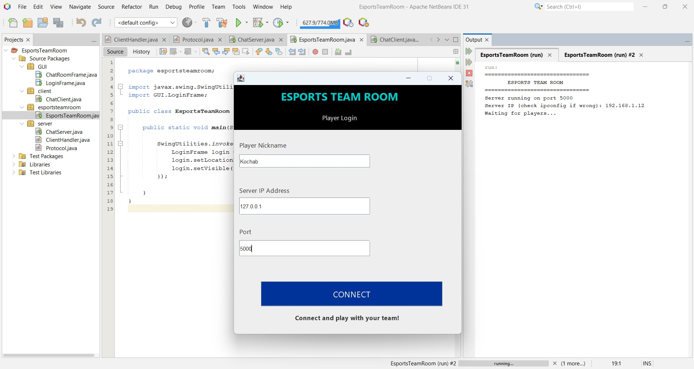
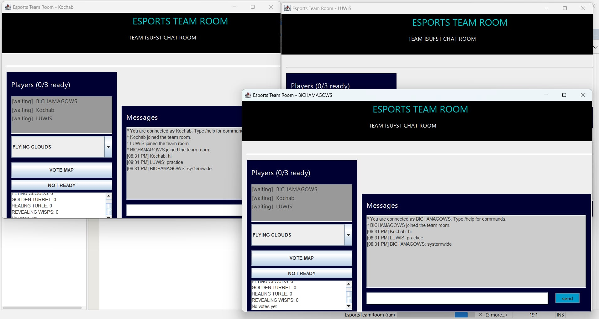
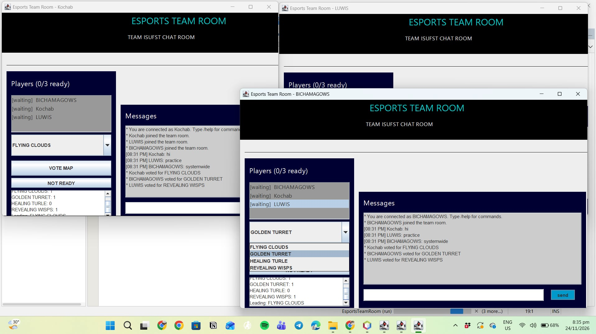
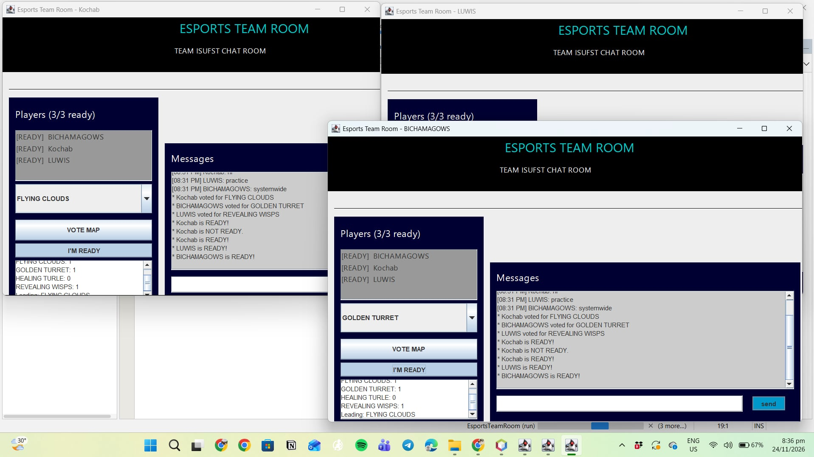

# Esports Team Room
# ITAS1-2BSD-SERENEO-MALUNES

A Java TCP LAN group-chat application for esports teammates. It includes concurrent client handling, unique nicknames, chat commands, map voting, and a team readiness check.

## Requirements

* JDK 26
* Apache NetBeans
* Two computers on the same Wi-Fi/LAN for the LAN demonstration

## Project structure

```text
TeamEsportRoom
├── src/
│   ├── GUI/
│   │   ├── LoginFrame.java
│   │   └── ChatRoomFrame.java
│   ├── client/
│   │   └── ChatClient.java
│   ├── esportsteamroom/
│   │   └── EsportsTeamRoom.java      (client entry point)
│   └── server/
│       ├── ChatServer.java           (server entry point)
│       ├── ClientHandler.java
│       └── Protocol.java
├── nbproject/
├── screenshots/
├── build.xml
├── manifest.mf
├── .gitignore
└── README.md
```
## Run the server

1. Open the project in IntelliJ IDEA.
2. Run `server.ChatServer` by creating a temporary run configuration, or use the `main` method below.
3. The server listens on TCP port `5000`.

For convenience, add this main method to `ChatServer` if you want to run it directly:

```java
public static void main(String\\\\\\\\\\\\\\\\\\\\\\\\\\\\\\\\\\\\\\\\\\\\\\\\\\\\\\\\\\\\\\\\\\\\\\\\\\\\\\\\\\\\\\\\\\\\\\\\\\\\\\\\\\\\\\\\\\\\\\\\\\\\\\\\\\\\\\\\\\\\\\\\\\\\\\\\\\\\\\\\\\\\\\\\\\\\\\\\\\\\\\\\\\\\\\\\\\\\\\\\\\\\\\\\\\\\\\\\\\\\\\\\\\\\\\\\\\\\\\\\\\\\\\\\\\\\\\\[] args) {
    new ChatServer(5000).start();
}
```

## Run the client

1. Keep the server running.
2. Run `Main`.
3. Enter a nickname, server IP, and port `5000`.
4. On the server computer, use `127.0.0.1`.
5. On another computer, enter the server computer's local IPv4 address.

## LAN setup

* Both computers must be connected to the same local network.
* Find the server computer's IPv4 address using `ipconfig` in Command Prompt.
* Allow Java through Windows Firewall when prompted.
* Use the server computer's IPv4 address on client computers.
* Do not expose the server to the public internet.

## Chat commands

* `/name NewName` - change your nickname
* `/help` - show help
* `/exit` - disconnect

## Original features

1. **Map Voting:** players vote for Erangel, Miramar, Sanhok, or Vikendi. Vote counts are shared by the server.
2. **Team Readiness:** players toggle READY/NOT READY. All clients receive the current team readiness list.

## Important implementation notes

* TCP sockets carry all client/server messages.
* The server creates a separate worker thread for each connected client using a cached thread pool.
* The server stores connected clients, votes, and readiness in concurrent maps.
* Server-side registration and shared-state updates are synchronized.
* Swing network reading runs on a background thread. UI changes are scheduled on the Swing Event Dispatch Thread.
* Data is stored in memory for the current server session only.

## Testing checklist

|Test|Expected result|
|-|-|
|Connect three clients|All three connect|
|Send a chat message|All connected clients receive it|
|Duplicate nickname|Server rejects the second user|
|Blank message|Client/server rejects it|
|`/name NewName`|Nickname and online list update|
|`/help`|Help text appears|
|`/exit`|Only that client disconnects|
|Vote for a map|Vote totals update for everyone|
|Toggle READY|Readiness list updates for everyone|
|Disconnect one client|Remaining clients continue chatting|

## Limitations / next improvements

* A player can currently change their vote by voting again.
* Readiness is reset when a player changes nickname.
* This starter version does not persist chat history or votes after server shutdown.
* Add instructor-approved visual design, screenshots, and a dated contribution log before submission.

## SCREENSHOTS for "LOGIN, CHATROOM, MAPVOTING, READINESS AND ERROR!"






## ASSISTANCE
** CHATGPT AND CLAUDE AI FOR ASSISTANCE
